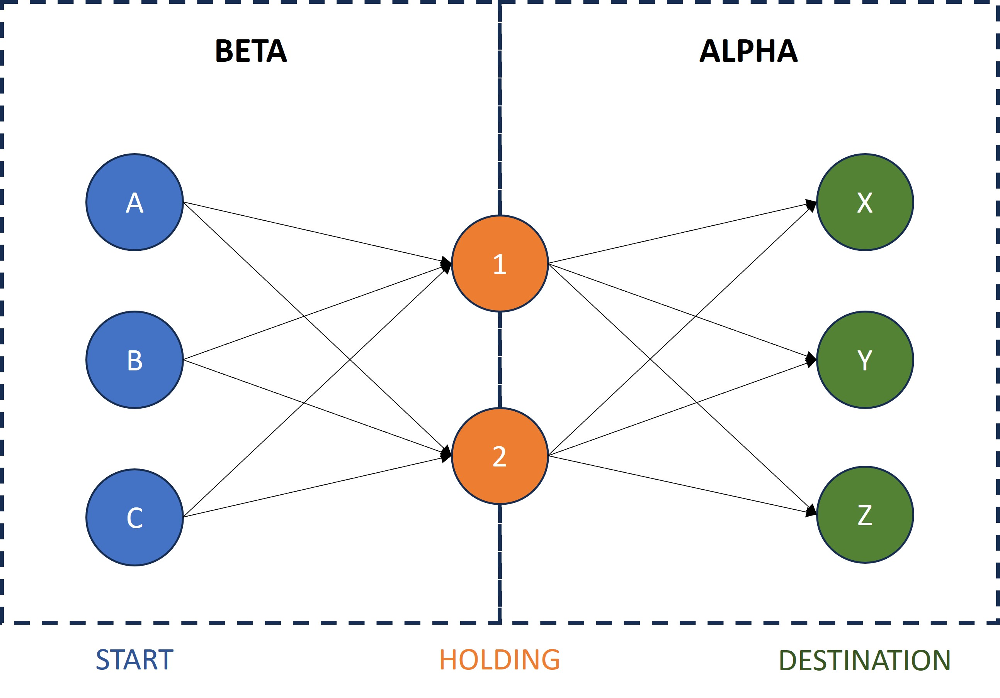

# Vehicle Routing and Personnel Scheduling with CP-SAT

Constraint-programming models (Google OR-Tools CP-SAT) for scheduling personnel and vehicles through a two-stage transport system.

**[▶ Live demo](https://jolikewe.github.io/vehicle_routing/)**: watch the optimal schedule animate, vehicle by vehicle.

 

## Overview

Personnel travel from START points to DESTINATION points via HOLDING points. Beta vehicles carry them from START to HOLDING, and Alpha vehicles from HOLDING to DESTINATION. Vehicles have limited capacity and can make several trips. The model decides which vehicle and trip each person takes, and the resulting arrival times, so that the total arrival time is minimised. The full formulation (variables, constraints, objectives, planned local-search ideas) is in [docs/problem_formulation.md](docs/problem_formulation.md).



## Results

Values below are taken from the stored notebook outputs and the notes in `notebooks/multi_multi.ipynb`.

| Notebook / model | Setup | Objective (sum of arrival times) |
| --- | --- | --- |
| `single_vehicle_cpsat.ipynb` | 5 personnel, 1 alpha + 1 beta vehicle | 68 |
| `multi_vehicle.ipynb` | 5 personnel, 1 alpha + 2 beta vehicles | 34 |
| `multi_multi.ipynb` (stored run) | 18 personnel, max 3 trips, capacity 3 | 531 (optimal) |
| `models/model_2.pkl` | 14 personnel, 4 trips, capacity 3 | 471 (9.3 min, per notebook note) |
| `models/model_3.pkl` | 18 personnel, 4 trips, capacity 3 | 531 (33 min, per notebook note) |

## Repository structure

```
.
├── notebooks/
│   ├── single_vehicle_cpsat.ipynb  # prototype: one alpha and one beta vehicle, single trip
│   ├── multi_vehicle.ipynb         # prototype: several vehicles, one trip each
│   ├── multi_multi.ipynb           # full model: several vehicles, several trips
│   └── planck_optimiser.py         # Model class (CP-SAT) used by multi_multi.ipynb
├── models/                         # pickled solved Model objects from multi_multi runs
├── docs/
│   ├── problem_formulation.md      # formulation, constraints, design notes
│   └── images/                     # diagrams
└── requirements.txt
```

## Getting started

```bash
pip install -r requirements.txt
cd notebooks
jupyter notebook
```

Run `multi_multi.ipynb` for the full model. It imports `planck_optimiser.py`, so start Jupyter from the `notebooks/` directory. The larger instances took minutes to tens of minutes in the original runs (see the notes in the notebook).

The pickles in `models/` were written with a specific OR-Tools version and may not load with a newer one; they are commented out in the notebook and are only kept as saved results.

## Limitations

- The maximum number of trips per vehicle must be fixed in advance; large values increase solve time sharply.
- The objective is the sum of arrival times, because CP-SAT cannot minimise a max/min of variables directly.
- The average waiting-time objective described in the formulation is not implemented in the notebooks.
